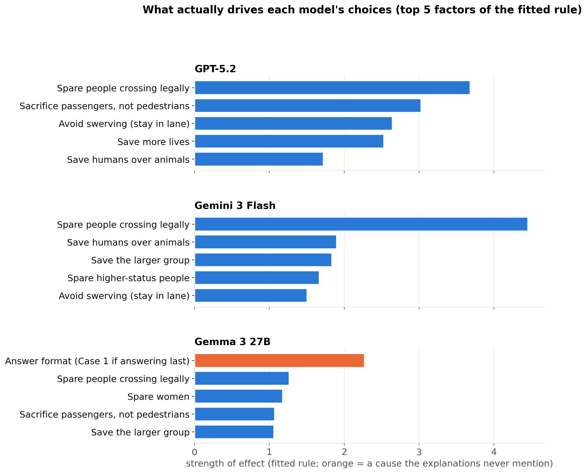
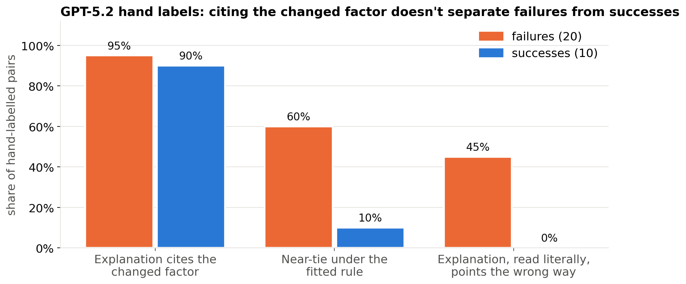
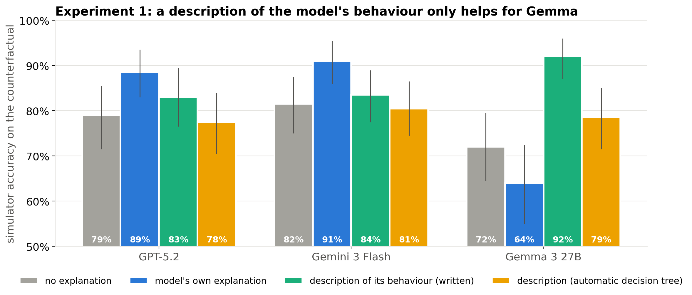
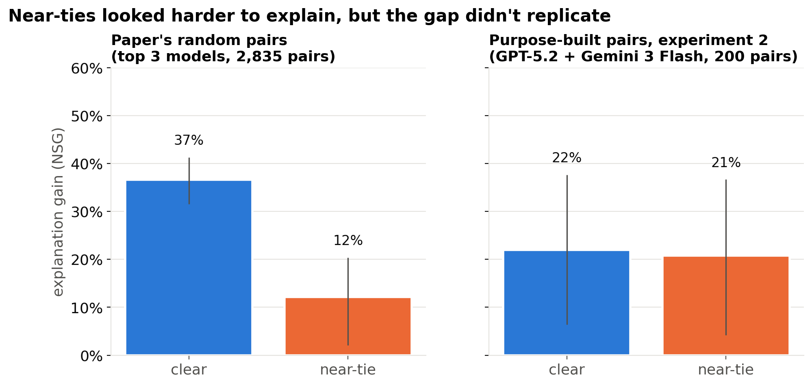
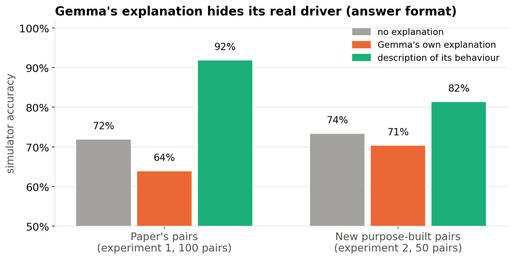

# Moral Machines: what we learned since the 10/08 debrief

*One section per slide. Figures are in `debrief/10_27_figures/` (regenerate: `python analysis/mm18_slides_figs.py`).
Interactive versions: `analysis/mm18_report.html` → Decision rule, Experiments.*

---

## Slide 1: Title

**Moral Machines: why simulators fail, and what an explanation leaves out**

Takeaway in one line: frontier models' explanations are about as useful as a description of how they actually
decide. Gemma's explanations hide its real driver, and a description of its behaviour exposes it.

---

## Slide 2: Where we were on 10/08

**What we had:**
- The paper's low Moral Machines NSG (6%) is mostly the open-weight models: proprietary 24%, open-weight −6%.
- Gemma 3 picks Case 1 about 95% of the time when asked for its answer last, and never says so.
- Half of all pairs change only head counts. The model rarely flips on them, so NSG is −8%.

**What the debrief asked for:**
- Generate counterfactuals, rather than first probing consistency.
- Focus on proprietary models at medium/high reasoning.
- Harry: get a "ground truth" for how each model decides, and use it.

---

## Slide 3: Step 1. What actually drives each model?

**Question:** can we write down how each model decides?

**Setup:**
- For each model, fit a simple rule (logistic regression) from the scenario's factors to its choices: law, passengers
  vs. pedestrians, swerving, number of lives, the demographic groups, answer format.
- Test it on pairs it wasn't fitted on.

**Finding:**
- The models are very predictable: the rule gets 92–96% of the top 3 models' choices right.
- GPT-5.2 is driven by **law, passengers vs. pedestrians, not swerving, and lives**. Gemini 3 Flash puts the law
  first, then humans vs. animals, group size and status.
- Gemma's biggest factor is **answer format**, which its explanations never mention.

---

## Slide 4: Step 2. Where do explanations stop helping? (paper's pairs)

**Question:** which counterfactuals carry little explanation signal?

**Setup:** use the fitted rule to measure how close each counterfactual is to a 50/50 call for the model (a "near-tie").

**Findings:**
- **Too close:** counts-only pairs leave no headroom. Predictors are already 91% right without the explanation, and
  NSG is −8%.
- **Near-ties:** NSG 12% on near-tie counterfactuals vs. 37% on clear ones (top 3 models, 2,835 pairs).
  ⚠️ This later **didn't replicate** (Slide 8).

---

## Slide 5: Step 3. Why do GPT-5.2's failures fail? (hand labels)

**Question:** do failures happen when the counterfactual changes something the explanation doesn't mention?

**Setup:**
- 30 GPT-5.2 pairs: 20 where predictors failed, 10 where they succeeded.
- Labelled blind to the outcome: which factors the explanation cites, and what it predicts if read literally.

**Findings:**
- **No.** Almost every counterfactual changes a factor the explanation cites (95% of failures, 90% of successes).
- What separates failures: being a near-tie (60% vs. 10%), and the explanation pointing the wrong way (45% vs. 0%).
- Typical failure: a **conditional rule whose condition doesn't hold**. For example, "when deaths are equal, protect
  law-abiding pedestrians", on a pair where deaths aren't equal.

**Citing a factor ≠ covering the counterfactual.**

---

## Slide 6: Experiment 1. Does a "ground truth" beat the model's own explanation?

**Question:** if a simulator gets a description of how the model *actually* decides, does it predict better than with
the model's own explanation? If so, the explanation is missing something.

**Setup:**
- 3 models: GPT-5.2, Gemini 3 Flash, and Gemma 3 27B as the control.
- 100 held-out pairs each, from the paper's own pairs.
- Two descriptions per model, written from other (training) pairs only:
  - **written:** by Claude, from the fitted rule, then checked claim by claim
  - **automatic:** from a small decision tree, with no judgment involved
- 2 simulators (gpt-oss-20b, Gemini 3 Flash).
- 5 conditions: none, own explanation, written description, automatic description, written + own.
- 3,000 calls.

---

## Slide 7: Experiment 1 results

| Simulator sees | GPT-5.2 | Gemini 3 Flash | Gemma 3 27B |
|---|---|---|---|
| no explanation | 79% | 82% | 72% |
| **own explanation** | **89%** | **91%** | 64% |
| description (written) | 83% | 84% | **92%** |
| description (automatic) | 78% | 81% | 79% |

*Accuracy of the simulator's prediction.*

- **Gemma:** its own explanation is worse than nothing. The description raises accuracy from 64% to 92% (NSG −29% →
  +71%). The automatic description also beats its own explanation, so this doesn't depend on Claude's writing.
- **GPT-5.2 and Gemini 3 Flash:** their own explanations do as well as or better than the description. There's no
  evidence a description adds information.
- **Simulators don't fully apply a written rule.** They reach 83–92% with it, while the rule itself reaches 88–96%.

---

## Slide 8: Experiment 2. Purpose-built counterfactuals

**Question:** on counterfactuals we choose on purpose, is explanation gain lower near the model's decision boundary?

**Setup:**
- New pairs built from scenarios each model already answered, so no new reference-model calls.
- Per model: 50 near-tie + 50 clear pairs.
- Each pair changes exactly 1 factor, with half of them flipping the answer.
- Own explanation vs. none; 2 simulators × 2 repeats; 3,000 calls.

**Finding: the near-tie gap didn't replicate.**
- NSG is 21% on near-tie pairs vs. 22% on clear ones (GPT-5.2 + Gemini 3 Flash; difference −1 point [−24, +22]).
- Near-ties are harder to predict with or without the explanation (65% vs. 76% accuracy), but the explanation helps
  about as much.
- So treat the Slide 4 result as **observational, not causal**.
- Cited vs. uncited couldn't be read: the cited pairs flip far more often (75% vs. 29%).

---

## Slide 9: Gemma's hidden cause holds on new counterfactuals

**Question:** does Gemma's description still help on counterfactuals it has never seen?

**Setup:** 50 new pairs built only from held-out scenarios.

**Finding: yes.** Accuracy is 71% with Gemma's own explanation, 74% with no explanation and 82% with the description
(NSG −11% → +30%).

That's 3 independent tests pointing the same way:
1. its explanation is worse than none
2. the description beats it on the paper's pairs
3. the description beats it on new pairs

---

## Slide 10: What changed since the debrief

| At the debrief we thought | Now |
|---|---|
| Low NSG might mean counterfactuals are "too far away" | It's not raw distance. Counts-only pairs are **too close** (no headroom), and a near-tie effect seen on the paper's pairs **didn't replicate** |
| Build counterfactuals from the factors explanations cite | Explanations already cite almost every factor. **Citing ≠ covering**: conditional rules fail outside their condition |
| Frontier explanations recover about half of what's predictable | That compared a fitted model with a reader. A description of their behaviour **doesn't beat** their own explanations |
| Gemma looks unfaithful (position bias) | **Confirmed 3 ways**: a description of its behaviour exposes what its explanation hides |

---

## Slide 11: Limitations

- **Small samples:** 30 hand-labelled pairs (one labeller); 100 held-out pairs per model in experiment 1. Intervals
  are wide.
- **Simulator noise:** the same prompt sent twice agrees 84–98% of the time. One frontier result moved 25 NSG points
  between two runs.
- **Self-simulation:** Gemini 3 Flash is both a reference model and one of the simulators.
- **Not comparable with the paper's NSG:** different samples, 2 simulators instead of 5. Compare within each
  experiment.
- **Cost so far:** $2.53 of the $50 key.

---

## Slide 12: Next steps (to Nov 2)

1. **Agree placement** in the shared report with Caleb (distance/coverage section) and Christina (non-determinism).
2. **Contribution to the toy-model story:**
   - Gemma as a real-world "known rule hidden from the explanation" case
   - "citing ≠ covering" as a real-data refinement of coverage
3. **Dropped:** resampling near-ties. Its motivation, the near-tie gap, didn't replicate.
4. **Open question for the team:** why does the near-tie gap appear on the generator's pairs but not on single-factor
   pairs?
