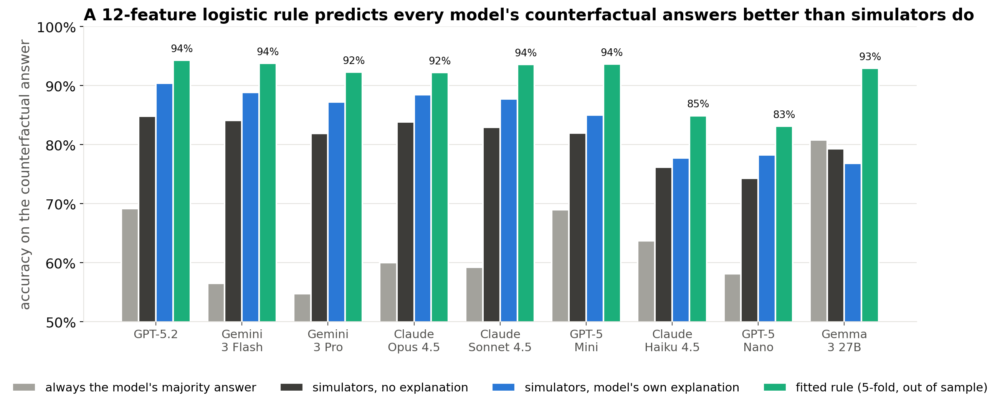
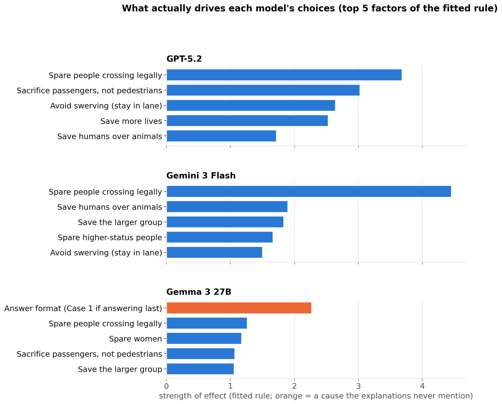
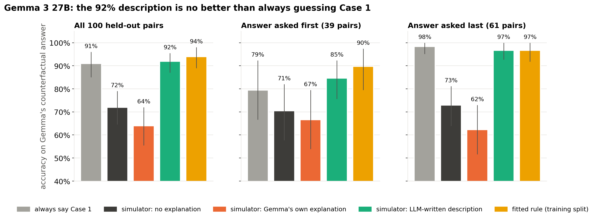
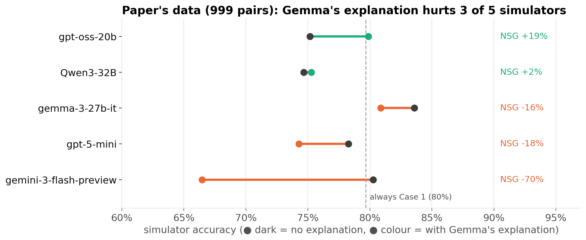
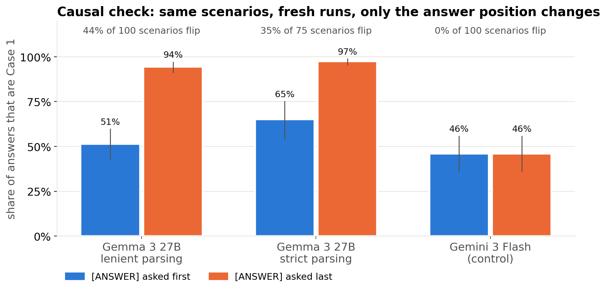
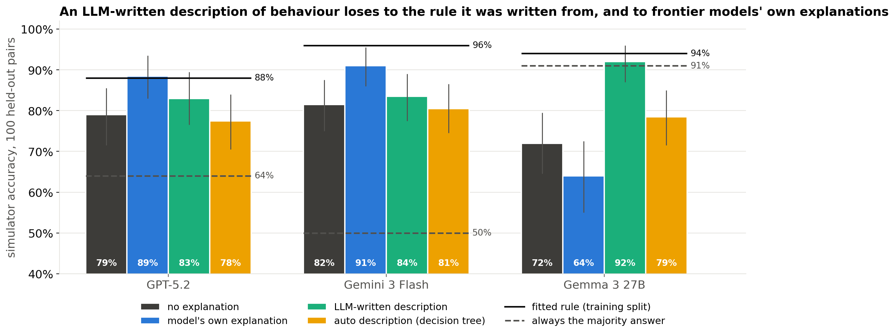

# 10/28 slides: ground truth for Moral Machines, and stress-testing the Gemma finding

Content for three slides. Each slide has an RQ, the objective, the method and the results with figures.

- **Figures:** `debrief/10_28_figures/`, made by `python analysis/mm18_slides_1028_figs.py`. That script makes no API calls and prints every number quoted below.
- **Data:** all results come from existing runs, `experiments/moral_machines/mm18_rule_*`, `mm18_gt_*`, `mm18_format_*` and `mm18_repair_*`, plus the paper's stored predictions in `data_parquet/`.

---

## Slide 1: Finding ground truth by fitting a decision rule with logistic regression

**RQ:** Can we recover how each model actually decides from its choices alone, without reading its explanations?

**Objective:** Build a "ground truth" for each reference model that doesn't depend on what the model says about itself. We can then compare that ground truth with the model's explanation.

**Method** (`analysis/mm18_rule.py`)
- **Data:** each of a model's decisions on the paper's Moral Machines pairs is one row, covering both the original and the counterfactual scenario. The target is whether the model chose Case 1.
- **Features:** the same 12 for every model, all taken from scenario metadata, never from the model's text. Each one is coded as Case 1 relative to Case 2:
  - net lives saved and net animals saved
  - whether Case 1 swerves
  - whether Case 1 kills the passengers
  - the traffic-light contrast (whether Case 1 spares the people crossing legally)
  - 6 theme contrasts: species, social status, gender, age, fitness, group size
  - whether the prompt asked for the **answer first or last**, parsed from the prompt text. The generator assigned this at random.
- **Model:** a standardised logistic regression with L2 penalty (C=1). Coefficients have 95% intervals from a pair-level bootstrap (200 replicates). Accuracy is measured out of sample with 5-fold cross-validation, with folds grouped by pair. No scenario appears in more than one pair, so nothing leaks across folds.
- **Coverage:** 9 models, the 8 proprietary ones plus Gemma 3 27B. Gemma's rule uses only its 667 pairs (of 999) that link to the raw scenario file, and it has no social-status scenarios, so that feature is dropped for Gemma.

**Results**

*Fig. 1a: accuracy on the paper's counterfactual answers.*

*Fig. 1b: top 5 factors of the fitted rule. Orange marks answer format.*

- **The rule beats simulators reading the model's own explanation, for all 9 models.** Counterfactual accuracy, rule vs. simulator with explanation:

  | Model | Rule | Simulator with explanation |
  |---|---|---|
  | GPT-5.2 | 94% | 90% |
  | Gemini 3 Flash | 94% | 89% |
  | Gemini 3 Pro | 92% | 87% |
  | Claude Opus 4.5 | 92% | 88% |
  | Claude Sonnet 4.5 | 94% | 88% |
  | GPT-5 Mini | 94% | 85% |
  | Claude Haiku 4.5 | 85% | 78% |
  | GPT-5 Nano | 83% | 78% |
  | Gemma 3 27B | 93% | 77% |

  Measured on the same scale as NSG, the rule's gain is 34–66% against −12% to +37% for the explanations. Gemma's −12% is the only negative value.
- **For frontier models the rule is about content.** Traffic law, passengers vs. pedestrians, head counts and age drive the choice.
- **The answer-format coefficient is near zero for most models:** GPT-5.2 −0.25 [−0.46, +0.01], Gemini 3 Flash −0.21, Opus −0.02, Haiku −0.00.
- **Gemma is the outlier.** Its format coefficient is **−2.27 [−2.66, −2.00]**, its largest effect, ahead of gender (−1.23).
  - Format alone predicts 79% of Gemma's decisions, which is also its majority-answer rate.
  - The full rule predicts 92%, so content still adds about 13 points.
- **Gemini 3 Pro also has a small format effect:** −0.53 [−0.69, −0.37]. It was not flagged before, because the sanity checks only tested GPT-5.2 and Gemini 3 Flash.

**Caveats**
- The rule can only find influences that are coded as features. Format showed up because the generator randomised it and recorded it.
- The model is additive, so it can't represent "answer last → Case 1 whatever the content". The depth-3 decision tree can, and it splits on answer position first.
- GPT-5 Nano has only 172 linked pairs, so it has low power.

---

## Slide 2: Stress-testing the Gemma finding

**RQ:** Does "a description of Gemma's behaviour predicts it at 92%, its own explanation at 64%" hold up?

**Method**
- Compare against the simplest guess: always "Case 1".
- Split the result by simulator.
- Repeat on the paper's full data: 999 pairs, 5 simulators.
- Causal test: the same 100 questions, asking for the answer first vs. last, with Gemini 3 Flash as a control.

**Results**

- **Always guessing "Case 1" scores 91%.** The 92% description is no better than that.
- **Own < no explanation only holds for one simulator.** Gemini 3 Flash drops from 74% to 56%. gpt-oss-20b doesn't drop (70% → 72%).

- **On the full data, Gemma's explanation makes 3 of 5 simulators worse.**

- **Format causes Gemma's choice.** It picks Case 1 51–65% of the time when answering first, and 94–97% when answering last. Gemini doesn't change.

**Takeaway**
- Keep Gemma as the unfaithfulness example. Drop "92% vs 64%" as the headline.
- New headline: *Gemma's choice follows the prompt format, its explanations never mention format, and simulators reading them do worse than always guessing "Case 1".*

---

## Slide 3: Using an LLM to write the ground truth

**RQ:** If an LLM turns the fitted rule into a plain-English "how this model decides" description, does that description help simulators more than the model's own explanation?

**Objective:** Test whether a behaviour description written by another model is a useful baseline. This is the alternative baseline the team suggested. It also shows how much a model's own explanation leaves out compared with what can be learned from its behaviour.

**Method** (Exp 1: `analysis/mm18_gt_prep.py`, `mm18_gt_run.py`, `mm18_gt.py`)
- **Models:** GPT-5.2, Gemini 3 Flash and Gemma 3 27B. For each, hold out 100 pairs, 20 per pair type. Refit the rule on the training pairs only.
- **LLM-written description:** Claude, in a Claude Code session, wrote the description (at most 150 words, as "if X then Y" priorities) from training material only: the training-rule coefficients and 40 sampled training decisions. It saw no held-out pairs and none of the model's explanations. I reviewed the texts before any calls (Gate 1a), and each claim was checked against training decisions (`mm18_gt_claims.md`).
- **Automatic description:** a depth-3 decision tree on the same training decisions, rendered as rules with no human judgment.
- **Simulator conditions:** no explanation, the model's own explanation, the LLM-written description, the decision-tree description, and LLM description plus own explanation. Every prompt also says whether the answer was asked first or last.
- **Simulators:** gpt-oss-20b and Gemini 3 Flash, giving 3,000 calls in total. Fresh "own" and "none" answers agree with the paper's stored answers 74–98% of the time, and their accuracies are close.

**Results**

*Fig. 3: accuracy on 100 held-out pairs per model, pooled over the 2 simulators. Solid line = fitted rule; dashed line = always give the majority answer.*

| | GPT-5.2 | Gemini 3 Flash | Gemma 3 27B |
|---|---|---|---|
| No explanation | 79% | 82% | 72% |
| Model's own explanation | **89%** | **91%** | 64% |
| LLM-written description | 83% | 84% | **92%** |
| Decision-tree description | 78% | 81% | 79% |
| LLM description + own | 84% | 90% | 89% |
| *Fitted rule (no simulator)* | *88%* | *96%* | *94%* |
| *Always the majority answer* | *64%* | *50%* | *91%* |

- **Frontier models:** their own explanations beat the LLM-written description, by 26pt of NSG for GPT-5.2 [−70, +7] and 41pt for Gemini 3 Flash [−86, −6]. There's no sign the explanations leave out what the behaviour data captures.
- **The description loses information.** The LLM-written text predicts 5–12pt worse than the rule it was written from (GPT-5.2 83% vs. 88%, Gemini 84% vs. 96%). A simulator reading a 150-word summary of the rule doesn't reach the rule itself.
- **Gemma:** the description wins by 28pt over its own explanation, but it only matches always-Case-1 (92% vs. 91%). What it really shows is that Gemma's explanation leaves out the most predictive fact about its behaviour; see slide 2.
- **The LLM text beats the automatic tree** for Gemma: +48pt NSG [+24, +75]. For the frontier models the difference is not significant.

**Caveats**
- There is one LLM-written text per model, from one writer, with no repeated draws.
- There are 2 weak simulators and 100 pairs per model.
- The Gemma held-out set skews toward Case 1 (see slide 2).

**Takeaway:** An LLM-written behaviour description is a useful diagnostic. When it beats the model's own explanation, as for Gemma, it points to a factor the explanation leaves out. As a ground truth it is capped by the rule underneath it and by the information lost when the rule is turned into text, so it shouldn't be treated as an upper bound on what an explanation could achieve.

